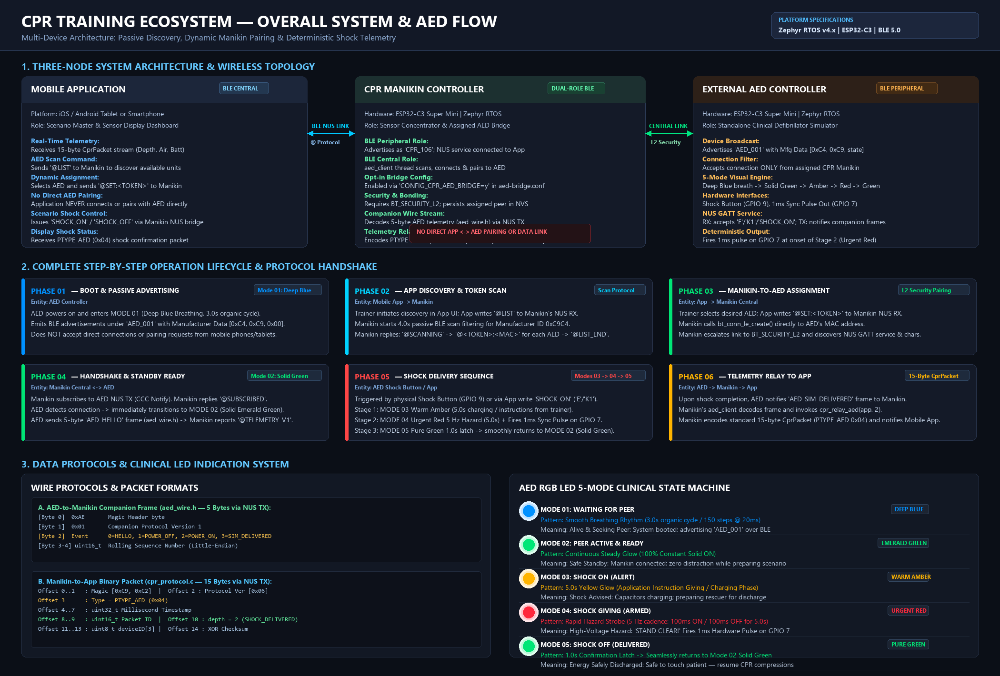

# CPR BLE Zephyr RTOS Controller (No LED Build)

Ultra-low-latency, deterministic CPR Training Monitor firmware running on **Zephyr RTOS v4.x** for the **ESP32-C3 Super Mini**.

---

## 1. System Overview & Dual-Role BLE Architecture



The CPR Manikin controller operates simultaneously as a **BLE Peripheral (GATT Server)** for the Mobile Training Application and as a **BLE Central (GATT Client)** for assigned external AED Shock Controllers:

```
                      ┌─────────────────────────┐
                      │    Mobile Application   │
                      │     (Tablet / Phone)    │
                      └────────────┬────────────┘
                                   │
                    BLE Link 1     │  1. Receives CPR Sensor Telemetry
                 (GATT Peripheral) │  2. Manages AED Assignment via '@' commands
                                   ▼
┌───────────────────────────────────────────────────────────────┐
│                    CPR Manikin Controller                     │
│                 ESP32-C3 Super Mini (Zephyr)                  │
│                                                               │
│  • Primary Service (NUS): Real-time Compression, Air, Batt    │
│  • Assigned AED Bridge  : Scans, pairs, & relays AED status   │
└──────────────────────────────┬────────────────────────────────┘
                               │
                    BLE Link 2 │  Direct Central Connection
                  (GATT Central)│  Subscribes to NUS TX notifications
                               ▼
┌───────────────────────────────────────────────────────────────┐
│                    AED Shock Controller                       │
│                 ESP32-C3 Super Mini (Zephyr)                  │
│                      Device: "AED_001"                        │
└───────────────────────────────────────────────────────────────┘
```

---

## 2. Hardware Pinout (ESP32-C3 Super Mini)

| Pin | Devicetree Node | Type | Hardware Mapping |
| :--- | :--- | :--- | :--- |
| **GPIO 0** | `adc0` (channel@0) | `ADC1_CH0` | 49E Linear Hall Sensor: **Chest AED Pad** (`A2`) |
| **GPIO 1** | `adc0` (channel@1) | `ADC1_CH1` | 49E Linear Hall Sensor: **Hip AED Pad** (`A1`) |
| **GPIO 2** | `adc0` (channel@2) | `ADC1_CH2` | Battery Voltage Divider (2:1, 100kΩ/100kΩ) |
| **GPIO 3** | `ir1_pin` | `gpio-keys` | Optical IR Shallow Sensor (Active-LOW) |
| **GPIO 4** | `ir2_pin` | `gpio-keys` | Optical IR Good Depth Sensor (Active-LOW) |
| **GPIO 6** | `motor_pwm_0` | `ledc0` PWM | 200 Hz Haptic Motor PWM for Lub-Dub heartbeats |
| **GPIO 8** | `i2c0` (SDA) | I2C Bus | Mouth Airway Pressure / Breath Sensor (BMP280 / HW-611) |
| **GPIO 9** | `i2c0` (SCL) | I2C Bus | Mouth Airway Pressure / Breath Sensor (BMP280 / HW-611) |

---

## 3. Dedicated Sensor Channels & Real-Time Telemetry

* **Chest AED (`A2`)**: Monitored strictly on **GPIO 0 (`ADC1_CH0`)**.
* **Hip AED (`A1`)**: Monitored strictly on **GPIO 1 (`ADC1_CH1`)**.
* **Compression Depth**: Optical IR interrupted sensors on **GPIO 3** (Shallow) and **GPIO 4** (Good depth) polled at 1 kHz with a 20 µs glitch filter.
* **Mouth Airway Breath Detection (`M1`/`M0`)**: Sampled at 50 Hz via BMP280 barometric pressure sensor on **I2C0 (GPIO 8/9)**.
* **Haptic Feedback**: High-definition dual-pulse cardiac cycle (Lub-Dub, 330 ms total duration) generated via hardware LEDC PWM on **GPIO 6**.

---

## 4. Assigned AED BLE Bridge Subsystem (`aed_client`)

When built with `CONFIG_CPR_AED_BRIDGE=y` (via `aed-bridge.conf`), the Manikin firmware enables an independent background Central engine to scan, pair, and communicate with nearby AED units.

### Mobile App Control Grammar (`@` Protocol)

Commands sent from the Mobile Application to the Manikin's NUS RX characteristic:

| Command | Action | Response from Manikin (NUS TX) |
| :--- | :--- | :--- |
| **`@LIST`** | Initiates a 4-second passive BLE scan for AEDs broadcasting manufacturer ID `0xC9C4` (`[0xC4, 0xC9, 0x00]`). | `@SCANNING`<br>`@<TOKEN>:<MAC_ADDR>` (per discovered AED)<br>`@LIST_END` |
| **`@SET:<TOKEN>`** | Assigns and initiates pairing with the selected AED token. | `@ASSIGNED`<br>`@PAIRING`<br>`@SECURED`<br>`@SUBSCRIBED`<br>`@TELEMETRY_V1` |
| **`@GET`** | Queries current AED assignment and connection status. | Returns status (`@SUBSCRIBED`, `@DISCONNECTED`, `@UNASSIGNED`) and `@PEER:<MAC>:<B/S>` |
| **`@CLEAR`** | Unpairs and disconnects current AED, clearing persistent storage. | `@RELEASING` followed by `@UNASSIGNED` |

### Security & State Persistence
* **Bonding & Encryption:** The bridge requires `BT_SECURITY_L2` before pairing.
* **Flash Storage:** Assigned AED peer identity is persisted in NVS (`trainer/peer`) via Zephyr Settings, automatically reconnecting upon reboot.

---

## 5. Companion Wire Protocol v1 (`aed_wire.h`)

Frames notified by the AED unit over NUS TX to the Manikin:

```
[Byte 0: 0xAE] [Byte 1: 0x01] [Byte 2: Event] [Bytes 3-4: 16-bit Sequence (LE)]
```

* **`0x00` (`AED_HELLO`)**: Arming frame sent immediately upon subscription; arms stream and prompts `@TELEMETRY_V1`.
* **`0x01` (`AED_POWER_OFF`)**: Relays `AED_STATE_OFF` (0) to App.
* **`0x02` (`AED_POWER_ON`)**: Relays `AED_STATE_ON` (1) to App.
* **`0x03` (`AED_SIM_DELIVERED`)**: Relays `AED_STATE_SHOCK_DELIVERED` (2) to App via standard 15-byte `CprPacket` (`PTYPE_AED`).

---

## 6. Binary Telemetry Packet Format (Manikin $\rightarrow$ Mobile App)

The Manikin streams fixed 15-byte binary packets (`CprPacket`) to the App:

| Offset | Field | Type | Description |
| :---: | :--- | :--- | :--- |
| **[0..1]** | `magic` | `uint8_t[2]` | `0xC9`, `0xC2` |
| **[2]** | `version` | `uint8_t` | `0x06` |
| **[3]** | `type` | `uint8_t` | `0x01` (Announce), `0x02` (Compression), `0x04` (AED), `0x05` (Air) |
| **[4..7]** | `timestamp` | `uint32_t` | Little-endian millisecond uptime |
| **[8..9]** | `id` | `uint16_t` | Rolling packet index |
| **[10]** | `depth` / `state` | `int8_t` | Sensor depth result or AED state code |
| **[11..13]** | `deviceID` | `uint8_t[3]`| Last 3 bytes of Bluetooth MAC |
| **[14]** | `checksum` | `uint8_t` | XOR of bytes [0..13] |

---

## 7. Build & Flash Instructions

### Option A: Flash Precompiled Zephyr Binary

```powershell
python -m esptool --chip esp32c3 --port COM7 --baud 921600 write_flash 0x0 bin/zephyr.bin
```

### Option B: Build from Source with AED Bridge Support

```powershell
# Environment setup
$env:ZEPHYR_BASE="C:\zephyrproject\zephyr"
$env:ZEPHYR_TOOLCHAIN_VARIANT="cross-compile"
$env:CROSS_COMPILE="C:/Users/sedhu/AppData/Local/Arduino15/packages/esp32/tools/esp-rv32/2601/bin/riscv32-esp-elf-"

# Configure CMake with AED bridge overlay
cmake -G Ninja -B build -S . -DBOARD=esp32c3_devkitm -DOVERLAY_CONFIG="aed-bridge.conf" -DCMAKE_C_FLAGS="-BC:/zb/as_bin/ -fno-lto -fno-use-linker-plugin"

# Compile and generate binary
ninja -C build zephyr/zephyr.elf
python -m esptool --chip esp32c3 elf2image --ram-only-header --flash-mode dio --flash-freq 80m --flash-size 4MB -o bin/zephyr.bin build/zephyr/zephyr.elf
```

---

## 8. Repository Layout

```
CPR_BLE_Zephyr_Controller_No_LED/
├── bin/
│   └── zephyr.bin                 ← Verified precompiled Zephyr binary
├── src/
│   ├── main.c                     ← Application entry point & sensor threads
│   ├── cpr_config.h               ← System pinout, timings, and protocol constants
│   ├── cpr_protocol.c / .h        ← 15-byte & 20-byte packet serialization
│   ├── ble_service.c / .h         ← BLE GATT NUS peripheral service
│   ├── aed_client.c / .h          ← Assigned AED BLE Central bridge engine
│   ├── aed_wire.h                 ← Companion 5-byte AED telemetry wire decoder
│   ├── ir_sensor.c / .h           ← 1 kHz optical compression sensing
│   ├── haptic.c / .h              ← High-definition cardiac PWM haptic driver
│   ├── aed_sensor.c / .h          ← Dual 49E linear Hall sensor ADC driver
│   ├── air_sensor.c / .h          ← BMP280 airway pressure breath detector
│   └── battery.c / .h             ← ADC battery voltage monitor & percentage
├── app.overlay                    ← Devicetree overlay for ESP32-C3 Super Mini
├── CMakeLists.txt                 ← Zephyr build configuration
├── Kconfig                        ← Opt-in symbols including CONFIG_CPR_AED_BRIDGE
├── aed-bridge.conf                ← Kconfig overlay enabling AED Central bridge
├── prj.conf                       ← Base Zephyr RTOS project configuration
└── README.md                      ← Documentation
```

---

## 9. Related Firmware

* **External AED Shock Controller (Zephyr RTOS):** [SMARTSsprb/CPR_Zephyr_AED_Controller](https://github.com/SMARTSsprb/CPR_Zephyr_AED_Controller)
